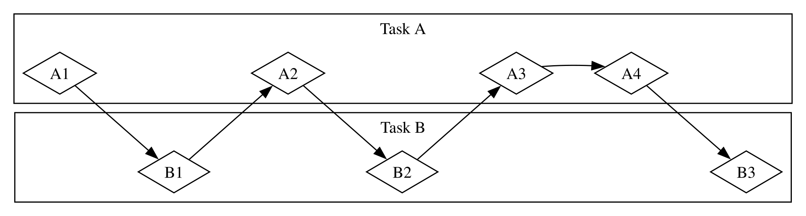
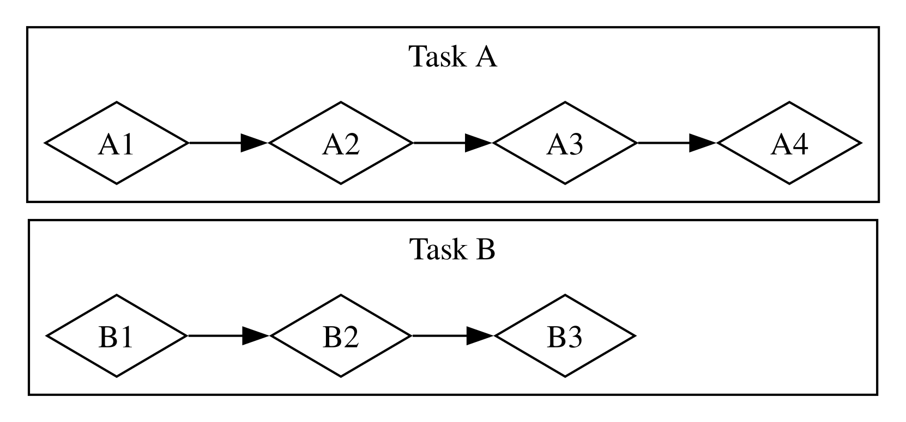
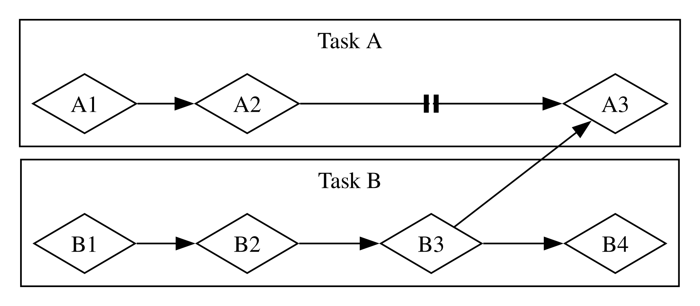

# Основы асинхронного программирования: async, await, фьючерсы и потоки

Многие операции, которые мы поручаем компьютеру, могут занимать продолжительное время. Было бы удобно, если бы во время ожидания завершения таких длительных процессов мы могли заниматься чем-нибудь ещё. Современные компьютеры предоставляют два способа работать более чем с одной операцией одновременно: параллелизм и конкурентность. Однако логика наших программ в основном записывается линейно. Нам хотелось бы указывать операции, которые должна выполнять программа, и точки, в которых функция может приостановиться, чтобы вместо неё могла выполняться другая часть программы, не задавая заранее точный порядок и способ выполнения каждого фрагмента кода. **Асинхронное программирование** — это абстракция, позволяющая описывать код через возможные точки приостановки и результаты, которые будут получены позднее, а детали координации выполнения она берёт на себя.

Эта глава развивает тему потоков, рассмотренную в главе 16 в контексте параллелизма и конкурентности, и представляет альтернативный подход к написанию кода: фьючерсы и потоки Rust, синтаксис `async` и `await`, позволяющий описывать асинхронные операции, а также сторонние крейты, реализующие асинхронные среды выполнения — код, который управляет выполнением асинхронных операций и координирует его.

Рассмотрим пример. Предположим, вы экспортируете видео, которое смонтировали из записи семейного праздника. Эта операция может занять от нескольких минут до нескольких часов. При экспорте видео будет использоваться максимально возможная вычислительная мощность CPU и GPU. Если бы у вас было только одно ядро CPU, а операционная система не приостанавливала экспорт до его завершения — то есть выполняла бы экспорт **синхронно**, — вы не могли бы делать на компьютере ничего другого, пока выполняется эта задача. Это было бы весьма неприятно. К счастью, операционная система вашего компьютера может незаметно прерывать экспорт и действительно делает это достаточно часто, чтобы вы могли одновременно заниматься другими делами.

Теперь представим, что вы скачиваете видео, которым поделился кто-то другой. Эта операция тоже может занять некоторое время, но она не требует столько вычислительных ресурсов CPU. В данном случае процессору приходится ждать поступления данных по сети. Читать данные можно начать сразу после того, как они начнут поступать, но получение всего файла может занять некоторое время. Даже после получения всех данных загрузка видео может занять ещё секунду или две, если файл достаточно большой. Возможно, это звучит незначительно, но для современного процессора это очень долго: он способен выполнять миллиарды операций в секунду. И здесь операционная система незаметно прерывает вашу программу, позволяя CPU выполнять другую работу, пока сетевой запрос не завершится.

Экспорт видео — пример операции, **ограниченной вычислительными ресурсами** (*CPU-bound* или *compute-bound*). Её скорость ограничена потенциальной производительностью обработки данных CPU или GPU и тем, какую часть этой производительности можно выделить операции. Скачивание видео — пример операции, **ограниченной вводом-выводом** (*I/O-bound*), поскольку её скорость ограничена производительностью ввода и вывода данных компьютера: она зависит от того, насколько быстро данные могут передаваться по сети.

В обоих примерах незаметные прерывания со стороны операционной системы обеспечивают некоторую форму конкурентности. Однако такая конкурентность существует только на уровне программы целиком: операционная система прерывает одну программу, чтобы другие программы могли выполнять свою работу. Во многих случаях мы понимаем устройство своих программ гораздо детальнее, чем операционная система, и поэтому можем замечать возможности для конкурентного выполнения, которые она не видит.

Например, если мы создаём инструмент для управления загрузками файлов, то должны иметь возможность написать программу так, чтобы запуск одной загрузки не блокировал пользовательский интерфейс, а пользователи могли запускать несколько загрузок одновременно. Однако многие API операционных систем для работы с сетью являются **блокирующими**: они останавливают выполнение программы, пока обрабатываемые ими данные не будут полностью готовы.

> Примечание: если задуматься, именно так работает большинство вызовов функций. Однако термин «блокирующий» обычно используют для вызовов функций, взаимодействующих с файлами, сетью или другими ресурсами компьютера, поскольку именно в этих случаях отдельная программа выиграла бы от неблокирующей операции.

Мы могли бы избежать блокировки основного потока, создавая отдельный поток для скачивания каждого файла. Однако со временем накладные расходы системных ресурсов, используемых этими потоками, стали бы проблемой. Было бы предпочтительнее, чтобы вызов изначально не блокировал выполнение, а вместо этого мы могли определить набор задач, которые должна выполнить программа, и позволить среде выполнения выбрать наилучший порядок и способ их выполнения.

Именно это и предоставляет абстракция Rust `async` (сокращение от *asynchronous*, «асинхронный»). В этой главе мы подробно изучим асинхронность и рассмотрим следующие темы:

- Как использовать синтаксис Rust `async` и `await` и выполнять асинхронные функции с помощью среды выполнения.
- Как использовать асинхронную модель для решения некоторых задач, рассмотренных нами в главе 16.
- Как многопоточность и асинхронность дополняют друг друга и во многих случаях могут использоваться совместно.

Прежде чем перейти к практическому рассмотрению асинхронности, нам нужно ненадолго остановиться и обсудить различия между параллелизмом и конкурентностью.

## Параллелизм и конкурентность

До этого момента мы использовали понятия параллелизма и конкурентности почти как взаимозаменяемые. Теперь нам нужно точнее разграничить их, поскольку эти различия проявятся в дальнейшей работе.

Представим, что команда распределяет задачи программного проекта. Можно поручить одному участнику несколько задач, назначить каждому участнику по одной задаче или сочетать оба подхода.

Когда один человек работает над несколькими задачами, прежде чем завершит хотя бы одну из них, это **конкурентность** (*concurrency*). Например, на вашем компьютере могут быть открыты два разных проекта. Если вы застряли на одном из них или устали от него, вы переключаетесь на другой. Вы всё ещё один человек и не можете продвигаться по обеим задачам в один и тот же момент, но можете переключаться между ними и поочерёдно продвигать каждую (см. рисунок 17-1).

<figure>

<figcaption>Рисунок 17-1. Конкурентный рабочий процесс с переключением между задачами A и B</figcaption>

</figure>

Когда команда распределяет набор задач так, что каждый участник получает одну задачу и работает над ней самостоятельно, это **параллелизм** (*parallelism*). Все участники команды могут продвигаться по своим задачам в один и тот же момент (см. рисунок 17-2).

<figure>

<figcaption>Рисунок 17-2. Параллельный рабочий процесс: задачи A и B выполняются независимо</figcaption>

</figure>

В обоих случаях может потребоваться координация между разными задачами. Возможно, вы считали, что задача одного участника совершенно не зависит от работы остальных, но на самом деле для её завершения сначала требуется результат другого участника. Часть работы можно выполнить параллельно, но другая часть должна выполняться **последовательно** (*serial*): одна задача за другой, как показано на рисунке 17-3.

<figure>

<figcaption>Рисунок 17-3. Частично параллельный рабочий процесс: задачи A и B выполняются независимо, пока задача A3 не оказывается заблокирована ожиданием результата B3</figcaption>

</figure>

Аналогично вы можете обнаружить, что одна из ваших задач зависит от другой вашей задачи. В таком случае конкурентная работа также становится последовательной.

Параллелизм и конкурентность могут пересекаться. Если вы узнаете, что коллега не может продолжить работу, пока вы не закончите одну из своих задач, вероятно, вы сосредоточитесь именно на ней, чтобы устранить блокировку. Вы с коллегой больше не можете работать параллельно, а вы сами больше не можете конкурентно продвигаться по своим задачам.

Те же основные закономерности применимы к программному и аппаратному обеспечению. На компьютере с одним ядром CPU процессор может выполнять только одну операцию в конкретный момент времени, но при этом работа всё равно может быть конкурентной. Используя такие инструменты, как потоки, процессы и асинхронность, компьютер может приостановить одну деятельность, переключиться на другую, а затем вернуться к первой. На компьютере с несколькими ядрами CPU возможен также параллелизм. Одно ядро может выполнять одну задачу, в то время как другое ядро выполняет совершенно другую; эти операции действительно происходят одновременно.

В Rust выполнение асинхронного кода обычно происходит конкурентно. В зависимости от аппаратного обеспечения, операционной системы и используемой асинхронной среды выполнения (о средах выполнения мы поговорим совсем скоро) такая конкурентность также может использовать параллелизм на нижнем уровне.

Теперь давайте разберёмся, как на самом деле работает асинхронное программирование в Rust.
