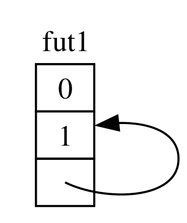
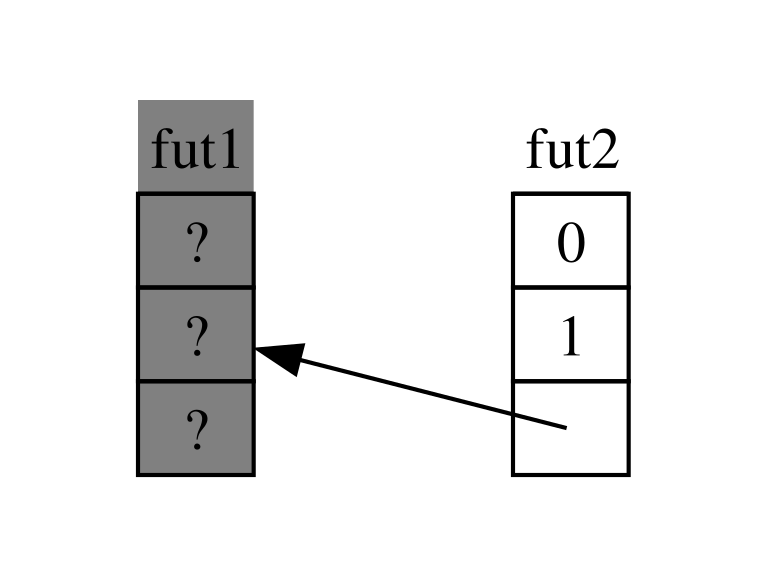
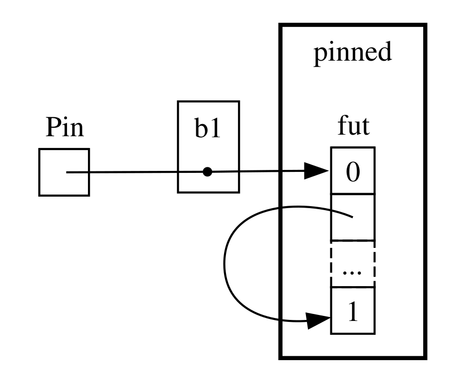
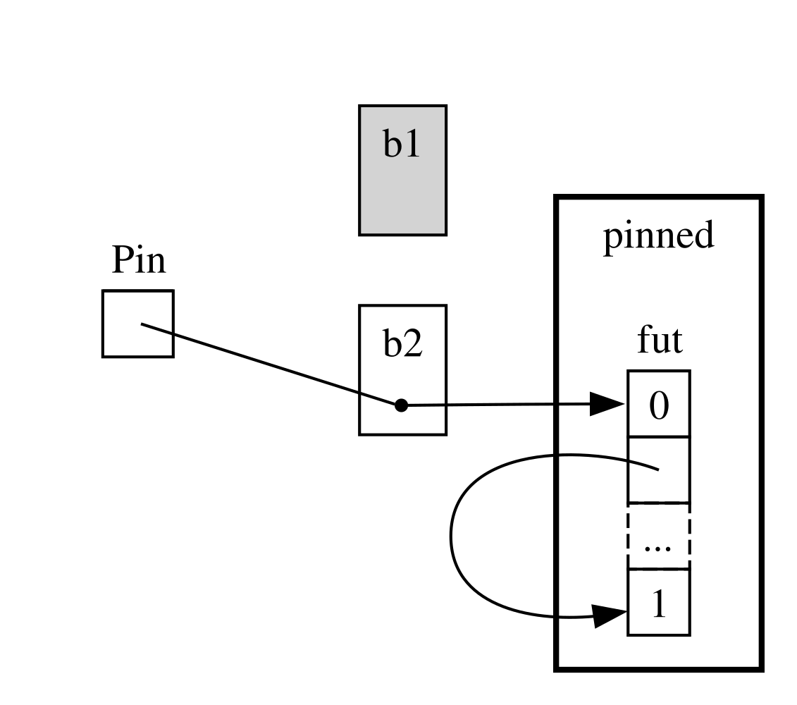
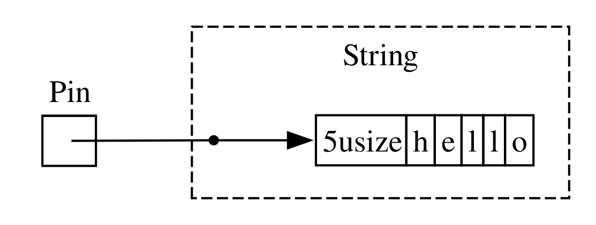
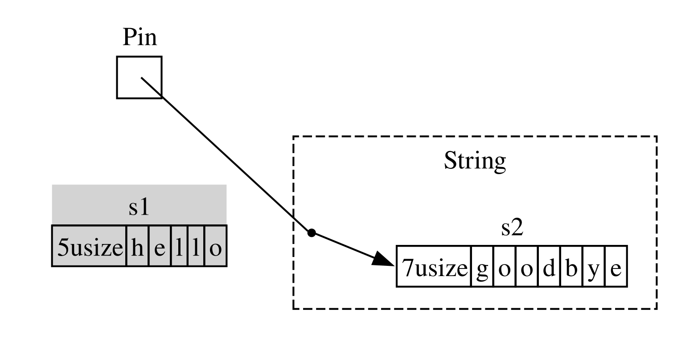

<!-- Old headings. Do not remove or links may break. -->

<a id="digging-into-the-traits-for-async"></a>

## Подробное рассмотрение трейтов для async

На протяжении всей главы мы по-разному использовали трейты `Future`, `Stream` и `StreamExt`. Однако до сих пор мы не углублялись в детали их работы и взаимодействия, что вполне нормально для большинства повседневных задач на Rust. Но иногда возникают ситуации, в которых необходимо лучше понимать некоторые подробности этих трейтов, а также тип `Pin` и трейт `Unpin`. В этом разделе мы разберём их ровно настолько подробно, чтобы вы могли справиться с такими ситуациями, оставив _по-настоящему_ глубокое изучение для другой документации.

<!-- Old headings. Do not remove or links may break. -->

<a id="future"></a>

### Трейт `Future`

Начнём с более подробного рассмотрения работы трейта `Future`. Вот как Rust определяет его:

```rust
use std::pin::Pin;
use std::task::{Context, Poll};

pub trait Future {
    type Output;

    fn poll(self: Pin<&mut Self>, cx: &mut Context<'_>) -> Poll<Self::Output>;
}
```

Это определение трейта содержит несколько новых типов и синтаксических конструкций, которые мы ещё не рассматривали, поэтому давайте разберём его по частям.

Во-первых, ассоциированный тип `Output` трейта `Future` указывает, к какому значению разрешается фьючерс. Это аналогично ассоциированному типу `Item` у трейта `Iterator`. Во-вторых, у `Future` есть метод `poll`, который принимает специальную ссылку `Pin` в качестве параметра `self` и изменяемую ссылку на тип `Context`, а возвращает `Poll<Self::Output>`. Чуть позже мы подробнее поговорим о `Pin` и `Context`. Пока сосредоточимся на типе возвращаемого значения — `Poll`:

```rust
pub enum Poll<T> {
    Ready(T),
    Pending,
}
```

Тип `Poll` похож на `Option`. У него есть один вариант со значением — `Ready(T)`, и один вариант без значения — `Pending`. Однако смысл `Poll` совсем не такой, как у `Option`! Вариант `Pending` означает, что фьючерсу ещё предстоит выполнить работу, поэтому вызывающая сторона должна будет проверить его снова позже. Вариант `Ready` означает, что `Future` завершил свою работу и значение типа `T` доступно.

> Примечание: Обычно метод `poll` не приходится вызывать напрямую. Но если такая необходимость возникнет, помните, что для большинства фьючерсов вызывающая сторона не должна повторно вызывать `poll` после того, как фьючерс вернул `Ready`. Многие фьючерсы при повторном опросе после перехода в готовое состояние вызовут панику. Фьючерсы, которые безопасно опрашивать повторно, явно указывают это в своей документации. Поведение похоже на поведение `Iterator::next`.

Когда вы видите код, использующий `await`, Rust под капотом компилирует его в код, вызывающий `poll`. Если вернуться к Листингу 17-4, в котором мы выводили заголовок страницы для одного URL после завершения загрузки, Rust компилирует его во что-то похожее (хотя и не полностью эквивалентное) на следующий код:

```rust,ignore
match page_title(url).poll() {
    Ready(page_title) => match page_title {
        Some(title) => println!("The title for {url} was {title}"),
        None => println!("{url} had no title"),
    }
    Pending => {
        // But what goes here?
    }
}
```

Что делать, если фьючерс всё ещё находится в состоянии `Pending`? Нам нужен способ пробовать снова, и снова, и снова, пока фьючерс наконец не будет готов. Другими словами, нам нужен цикл:

```rust,ignore
let mut page_title_fut = page_title(url);
loop {
    match page_title_fut.poll() {
        Ready(value) => match page_title {
            Some(title) => println!("The title for {url} was {title}"),
            None => println!("{url} had no title"),
        }
        Pending => {
            // continue
        }
    }
}
```

Однако если бы Rust компилировал код именно так, каждый `await` блокировал бы выполнение — то есть происходило бы ровно обратное тому, чего мы хотели добиться! Вместо этого Rust гарантирует, что цикл сможет передать управление чему-то, что приостановит работу над этим фьючерсом, позволит выполнить другие фьючерсы, а затем вернётся к проверке первого. Как мы уже видели, эту задачу выполняет асинхронная среда выполнения, а планирование и координация являются одними из её основных обязанностей.

В разделе [«Передача данных между двумя задачами с помощью обмена сообщениями»][message-passing]<!-- ignore --> мы описывали ожидание `rx.recv`. Вызов `recv` возвращает фьючерс, а ожидание этого фьючерса приводит к его опросу. Мы отмечали, что среда выполнения приостановит фьючерс до тех пор, пока он не будет готов вернуть `Some(message)` или `None` при закрытии канала. Теперь, лучше понимая трейт `Future` и, в частности, `Future::poll`, мы можем увидеть, как это работает. Среда выполнения понимает, что фьючерс ещё не готов, когда он возвращает `Poll::Pending`. И наоборот, когда `poll` возвращает `Poll::Ready(Some(message))` или `Poll::Ready(None)`, среда выполнения понимает, что фьючерс _готов_, и продвигает его выполнение дальше.

Точные детали того, как среда выполнения это делает, выходят за рамки этой книги. Главное — понять базовый механизм работы фьючерсов: среда выполнения _опрашивает_ каждый фьючерс, за который отвечает, и снова приостанавливает его, если он пока не готов.

<!-- Old headings. Do not remove or links may break. -->

<a id="pinning-and-the-pin-and-unpin-traits"></a>
<a id="the-pin-and-unpin-traits"></a>

### Тип `Pin` и трейт `Unpin`

В Листинге 17-13 мы использовали макрос `trpl::join!`, чтобы ожидать три фьючерса. Однако часто возникает необходимость работать с коллекцией, например вектором, содержащим некоторое количество фьючерсов, которое станет известно только во время выполнения. Давайте изменим Листинг 17-13: поместим три фьючерса в вектор и вместо этого вызовем функцию `trpl::join_all`, как показано в Листинге 17-23. Пока этот код не компилируется.

<Listing number="17-23" caption="Ожидание фьючерсов, находящихся в коллекции" file-name="src/main.rs">

```rust,ignore,does_not_compile
{{#rustdoc_include ../listings/ch17-async-await/listing-17-23/src/main.rs:here}}
```

</Listing>

Мы помещаем каждый фьючерс в `Box`, чтобы превратить их в _объекты трейтов_, как мы делали в разделе «Возврат ошибок из `run`» главы 12. (Подробно объекты трейтов мы рассмотрим в главе 18.) Использование объектов трейтов позволяет обращаться с каждым анонимным фьючерсом, созданным этими типами, как с одним и тем же типом, поскольку все они реализуют трейт `Future`.

Это может показаться неожиданным. Ведь ни один из асинхронных блоков ничего не возвращает, поэтому каждый из них создаёт `Future<Output = ()>`. Однако помните, что `Future` — это трейт, а компилятор создаёт уникальное перечисление для каждого асинхронного блока, даже если типы их выходных значений совпадают. Подобно тому как нельзя поместить две разные структуры, написанные вручную, в один `Vec`, нельзя смешивать и перечисления, сгенерированные компилятором.

Затем мы передаём коллекцию фьючерсов в функцию `trpl::join_all` и ожидаем её результат. Однако код не компилируется. Вот соответствующая часть сообщений об ошибках:

<!-- manual-regeneration
cd listings/ch17-async-await/listing-17-23
cargo build
copy *only* the final `error` block from the errors
-->

```text
error[E0277]: `dyn Future<Output = ()>` cannot be unpinned
  --> src/main.rs:48:33
   |
48 |         trpl::join_all(futures).await;
   |                                 ^^^^^ the trait `Unpin` is not implemented for `dyn Future<Output = ()>`
   |
   = note: consider using the `pin!` macro
           consider using `Box::pin` if you need to access the pinned value outside of the current scope
   = note: required for `Box<dyn Future<Output = ()>>` to implement `Future`
note: required by a bound in `futures_util::future::join_all::JoinAll`
  --> file:///home/oai/.cargo/registry/src/index.crates.io-1949cf8c6b5b557f/futures-util-0.3.30/src/future/join_all.rs:29:8
   |
27 | pub struct JoinAll<F>
   |            ------- required by a bound in this struct
28 | where
29 |     F: Future,
   |        ^^^^^^ required by this bound in `JoinAll`
```

Примечание в этом сообщении об ошибке подсказывает, что для _закрепления_ значений следует использовать макрос `pin!`, то есть поместить их внутрь типа `Pin`, который гарантирует, что значения не будут перемещены в памяти. В сообщении об ошибке говорится, что закрепление необходимо, поскольку `dyn Future<Output = ()>` должен реализовать трейт `Unpin`, но в данный момент не реализует его.

Функция `trpl::join_all` возвращает структуру `JoinAll`. Эта структура обобщена по типу `F`, для которого установлено ограничение: он должен реализовывать трейт `Future`. При непосредственном ожидании фьючерса с помощью `await` закрепление выполняется неявно. Поэтому нам не нужно использовать `pin!` везде, где мы хотим ожидать фьючерс.

Однако здесь мы не ожидаем фьючерс напрямую. Вместо этого мы создаём новый фьючерс `JoinAll`, передавая коллекцию фьючерсов функции `join_all`. Сигнатура `join_all` требует, чтобы типы элементов коллекции реализовывали трейт `Future`, а `Box<T>` реализует `Future` только в том случае, если обёрнутый тип `T` является фьючерсом, реализующим трейт `Unpin`.

Всё это довольно непросто усвоить! Чтобы действительно понять происходящее, давайте подробнее разберём работу трейта `Future`, в частности закрепление. Ещё раз взглянем на определение трейта `Future`:

```rust
use std::pin::Pin;
use std::task::{Context, Poll};

pub trait Future {
    type Output;

    // Required method
    fn poll(self: Pin<&mut Self>, cx: &mut Context<'_>) -> Poll<Self::Output>;
}
```

Параметр `cx` и его тип `Context` — ключ к тому, как среда выполнения определяет, когда нужно проверять тот или иной фьючерс, сохраняя при этом ленивость выполнения. Повторимся: подробности этой работы выходят за рамки главы, и обычно задумываться о них нужно только при написании собственной реализации `Future`. Вместо этого сосредоточимся на типе `self`, поскольку впервые встречаем метод, в котором для `self` явно указана аннотация типа. Аннотация типа для `self` работает так же, как аннотации типов для других параметров функции, но имеет два важных отличия:

- Она сообщает Rust, какого типа должен быть `self`, чтобы можно было вызвать метод.
- Это не может быть произвольный тип. Он ограничен типом, для которого реализован метод, ссылкой или умным указателем на этот тип либо типом `Pin`, оборачивающим ссылку на этот тип.

Подробнее этот синтаксис мы рассмотрим в [главе 18][ch-18]<!-- ignore -->. Пока достаточно знать, что для опроса фьючерса и проверки того, находится ли он в состоянии `Pending` или `Ready(Output)`, нам нужна изменяемая ссылка на тип, обёрнутая в `Pin`.

`Pin` — это обёртка для типов, похожих на указатели, например `&`, `&mut`, `Box` и `Rc`. (Технически `Pin` работает с типами, реализующими трейты `Deref` или `DerefMut`, но фактически это эквивалентно работе только со ссылками и умными указателями.) Сам `Pin` не является указателем и не обладает собственным поведением, подобным подсчёту ссылок в `Rc` и `Arc`; это исключительно инструмент, который компилятор может использовать для обеспечения ограничений на использование указателей.

Вспомнив, что `await` реализован через вызовы `poll`, мы можем понять часть сообщения об ошибке, которое видели ранее. Однако оно касалось `Unpin`, а не `Pin`. Как именно `Pin` связан с `Unpin` и почему для вызова `poll` трейт `Future` требует, чтобы `self` находился внутри типа `Pin`?

Помните, что ранее в этой главе мы говорили: последовательность точек ожидания во фьючерсе компилируется в машину состояний, а компилятор следит за тем, чтобы эта машина состояний соблюдала все обычные правила безопасности Rust, включая правила заимствования и владения. Для этого Rust анализирует, какие данные нужны между одной точкой ожидания и следующей точкой ожидания либо концом асинхронного блока. Затем он создаёт соответствующий вариант в скомпилированной машине состояний. Каждый вариант получает необходимый доступ к данным, которые будут использоваться в соответствующей части исходного кода: либо принимая владение этими данными, либо получая изменяемую или неизменяемую ссылку на них.

Пока всё хорошо: если в каком-либо асинхронном блоке мы допустим ошибку с владением или ссылками, об этом сообщит проверяющий заимствования. Но когда мы захотим переместить фьючерс, соответствующий этому блоку, — например, поместить его в `Vec`, чтобы передать в `join_all`, — всё становится сложнее.

Когда мы перемещаем фьючерс — добавляя его в структуру данных, чтобы использовать в качестве итератора с `join_all`, или возвращая его из функции, — фактически перемещается созданная Rust машина состояний. И в отличие от большинства других типов Rust, фьючерсы, создаваемые для асинхронных блоков, могут содержать ссылки на самих себя в полях отдельных вариантов, как показано на упрощённой схеме на Рисунке 17-4.

<figure>



<figcaption>Рисунок 17-4. Тип данных со ссылкой на самого себя</figcaption>

</figure>

По умолчанию любой объект, содержащий ссылку на самого себя, небезопасно перемещать, поскольку ссылки всегда указывают на фактический адрес памяти объекта, на который они ссылаются (см. Рисунок 17-5). Если переместить саму структуру данных, её внутренние ссылки продолжат указывать на старое местоположение. Однако эта область памяти теперь недействительна. Во-первых, её значение не будет обновляться при изменении структуры данных. Во-вторых, и это важнее, компьютер теперь может повторно использовать эту область памяти для других целей! В результате позднее вы можете прочитать совершенно посторонние данные.

<figure>



<figcaption>Рисунок 17-5. Небезопасный результат перемещения типа данных со ссылкой на самого себя</figcaption>

</figure>

Теоретически компилятор Rust мог бы пытаться обновлять каждую ссылку на объект при каждом его перемещении, но это создало бы значительные накладные расходы, особенно если пришлось бы обновлять целую сеть ссылок. Если бы вместо этого мы могли гарантировать, что рассматриваемая структура данных _не перемещается в памяти_, обновлять ссылки не пришлось бы. Именно для этого и нужен проверяющий заимствования Rust: в безопасном коде он не позволяет перемещать элемент, на который существует активная ссылка.

`Pin` развивает эту идею и предоставляет именно ту гарантию, которая нам нужна. Когда мы _закрепляем_ значение, оборачивая указатель на него в `Pin`, это значение больше нельзя перемещать. Таким образом, если у вас есть `Pin<Box<SomeType>>`, закрепляется само значение `SomeType`, _а не_ указатель `Box`. Этот процесс показан на Рисунке 17-6.

<figure>



<figcaption>Рисунок 17-6. Закрепление Box, указывающего на тип фьючерса со ссылкой на самого себя</figcaption>

</figure>

На самом деле указатель `Box` по-прежнему можно свободно перемещать. Помните: нам важно, чтобы данные, на которые в конечном счёте ссылаются указатели, оставались на прежнем месте. Если перемещается указатель, _но данные, на которые он указывает_, остаются на том же месте, как на Рисунке 17-7, потенциальной проблемы нет. (В качестве самостоятельного упражнения изучите документацию типов и модуля `std::pin` и попробуйте разобраться, как сделать это с помощью `Pin`, оборачивающего `Box`.) Главное, что сам тип со ссылкой на себя не может перемещаться, поскольку он остаётся закреплённым.

<figure>



<figcaption>Рисунок 17-7. Перемещение Box, указывающего на тип фьючерса со ссылкой на самого себя</figcaption>

</figure>

Однако большинство типов совершенно безопасно перемещать, даже если они находятся за указателем `Pin`. О закреплении нужно задумываться только тогда, когда элементы содержат внутренние ссылки. Примитивные значения, например числа и логические значения, безопасны, поскольку в них очевидно нет внутренних ссылок. Их нет и у большинства типов, с которыми вы обычно работаете в Rust. Например, вы можете перемещать `Vec`, не беспокоясь об этом. Если исходить из того, что мы уже узнали, то при наличии `Pin<Vec<String>>` пришлось бы выполнять все операции через безопасный, но ограниченный API, предоставляемый `Pin`, хотя `Vec<String>` всегда безопасно перемещать, если на него нет других ссылок. Нам нужен способ сообщить компилятору, что в таких случаях перемещение элементов допустимо. Здесь и появляется `Unpin`.

`Unpin` — это маркерный трейт, похожий на трейты `Send` и `Sync`, которые мы рассматривали в главе 16. Поэтому у него нет собственной функциональности. Маркерные трейты существуют только для того, чтобы сообщить компилятору, что тип, реализующий определённый трейт, безопасно использовать в некотором контексте. `Unpin` сообщает компилятору, что для данного типа _не требуется_ соблюдать какие-либо гарантии относительно возможности безопасного перемещения соответствующего значения.

<!--
  The inline `<code>` in the next block is to allow the inline `<em>` inside it,
  matching what NoStarch does style-wise, and emphasizing within the text here
  that it is something distinct from a normal type.
-->

Как и в случае с `Send` и `Sync`, компилятор автоматически реализует `Unpin` для всех типов, для которых может доказать безопасность такой реализации. Особый случай, опять же похожий на `Send` и `Sync,` — это ситуация, когда `Unpin` для типа _не_ реализован. Такая ситуация обозначается записью <code>impl !Unpin for <em>SomeType</em></code>, где <code><em>SomeType</em></code> — имя типа, который должен соблюдать соответствующие гарантии, чтобы оставаться безопасным при использовании указателя на него внутри `Pin`.

Иными словами, во взаимосвязи `Pin` и `Unpin` нужно помнить о двух вещах. Во-первых, `Unpin` — это «обычный» случай, а `!Unpin` — особый. Во-вторых, то, реализует ли тип `Unpin` или `!Unpin`, имеет значение _только_ при использовании закреплённого указателя на этот тип, например <code>Pin<&mut <em>SomeType</em>></code>.

Чтобы сделать это более наглядным, рассмотрим `String`: он содержит длину и составляющие его символы Unicode. Мы можем обернуть `String` в `Pin`, как показано на Рисунке 17-8. Однако `String`, как и большинство других типов в Rust, автоматически реализует `Unpin`.

<figure>



<figcaption>Рисунок 17-8. Закрепление String; пунктирная линия показывает, что String реализует трейт Unpin и поэтому фактически не закреплён</figcaption>

</figure>

В результате мы можем выполнять действия, которые были бы запрещены, если бы `String` вместо этого реализовывал `!Unpin`. Например, мы можем заменить одну строку другой в том же самом месте памяти, как показано на Рисунке 17-9. Это не нарушает контракт `Pin`, поскольку у `String` нет внутренних ссылок, из-за которых его было бы небезопасно перемещать. Именно поэтому он реализует `Unpin`, а не `!Unpin`.

<figure>



<figcaption>Рисунок 17-9. Замена String совершенно другим значением String в памяти</figcaption>

</figure>

Теперь мы знаем достаточно, чтобы понять ошибки, возникшие при вызове `join_all` в Листинге 17-23. Изначально мы пытались переместить фьючерсы, созданные асинхронными блоками, в `Vec<Box<dyn Future<Output = ()>>>`. Но, как мы уже увидели, эти фьючерсы могут содержать внутренние ссылки, поэтому они не реализуют `Unpin` автоматически. После закрепления мы можем передать полученный тип `Pin` в `Vec`, будучи уверенными, что лежащие в основе фьючерсов данные _не_ будут перемещены. В Листинге 17-24 показано, как исправить код: вызвать макрос `pin!` там, где определяется каждый из трёх фьючерсов, и изменить тип объекта трейта.

<Listing number="17-24" caption="Закрепление фьючерсов, позволяющее переместить их в вектор">

```rust
{{#rustdoc_include ../listings/ch17-async-await/listing-17-24/src/main.rs:here}}
```

</Listing>

Теперь этот пример компилируется и запускается. Мы также могли бы добавлять фьючерсы в вектор и удалять их из него во время выполнения, а затем объединять их все.

`Pin` и `Unpin` в основном важны при создании низкоуровневых библиотек или самой среды выполнения, а не при повседневном написании кода на Rust. Но теперь, когда вы встретите эти трейты в сообщениях об ошибках, вы будете лучше понимать, как исправить свой код!

> Примечание: Сочетание `Pin` и `Unpin` позволяет безопасно реализовать в Rust целый класс сложных типов, которые иначе было бы трудно создать из-за ссылок на самих себя. Сегодня типы, требующие `Pin`, чаще всего встречаются в асинхронном Rust, но иногда вы можете увидеть их и в других контекстах.
>
> Подробное описание работы `Pin` и `Unpin`, а также правил, которые они должны соблюдать, содержится в документации API для `std::pin`. Если вы хотите узнать больше, это отличная отправная точка.
>
> Если вы хотите ещё глубже разобраться в том, что происходит под капотом, обратитесь ко второй [главе][under-the-hood]<!-- ignore --> и четвёртой [главе][pinning]<!-- ignore --> книги [_Asynchronous Programming in Rust_][async-book].

### Трейт `Stream`

Теперь, когда вы лучше понимаете трейты `Future`, `Pin` и `Unpin`, мы можем перейти к трейту `Stream`. Как вы узнали ранее в этой главе, потоки похожи на асинхронные итераторы. Однако, в отличие от `Iterator` и `Future`, на момент написания этой книги `Stream` не имеет определения в стандартной библиотеке. Тем не менее существует очень распространённое определение из крейта `futures`, которое используется во всей экосистеме.

Прежде чем посмотреть, как трейт `Stream` может объединить возможности двух других трейтов, вспомним определения `Iterator` и `Future`. От `Iterator` мы получаем идею последовательности: его метод `next` предоставляет `Option<Self::Item>`. От `Future` мы получаем идею готовности с течением времени: его метод `poll` предоставляет `Poll<Self::Output>`. Чтобы представить последовательность элементов, которые становятся готовыми с течением времени, мы определяем трейт `Stream`, объединяющий эти возможности:

```rust
use std::pin::Pin;
use std::task::{Context, Poll};

trait Stream {
    type Item;

    fn poll_next(
        self: Pin<&mut Self>,
        cx: &mut Context<'_>
    ) -> Poll<Option<Self::Item>>;
}
```

Трейт `Stream` определяет ассоциированный тип `Item`, задающий тип элементов, создаваемых потоком. Это похоже на `Iterator`, у которого может быть от нуля до множества элементов, и отличается от `Future`, у которого всегда есть одно значение `Output`, даже если его тип — `()`.

`Stream` также определяет метод для получения этих элементов. Мы называем его `poll_next`, чтобы показать, что он опрашивает поток так же, как `Future::poll`, и создаёт последовательность элементов так же, как `Iterator::next`. Его возвращаемый тип объединяет `Poll` и `Option`. Внешний тип — `Poll`, поскольку, как и фьючерс, поток нужно проверять на готовность. Внутренний тип — `Option`, поскольку, как и итератор, поток должен сообщать, остались ли ещё сообщения.

Что-то очень похожее на это определение, вероятно, в итоге станет частью стандартной библиотеки Rust. А пока оно входит в набор инструментов большинства сред выполнения, поэтому на него можно рассчитывать. Всё, что мы рассмотрим далее, в целом должно применяться и к нему!

Однако в примерах из раздела [«Потоки: последовательности фьючерсов»][streams]<!-- ignore --> мы не использовали ни `poll_next`, ни `Stream`. Вместо этого мы применяли `next` и `StreamExt`. Конечно, мы _могли бы_ вручную работать непосредственно с API `poll_next`, самостоятельно написав машины состояний для `Stream`, точно так же, как _могли бы_ работать с фьючерсами напрямую через их метод `poll`. Но использовать `await` гораздо удобнее, а трейт `StreamExt` предоставляет метод `next`, позволяющий именно так и поступать:

```rust
{{#rustdoc_include ../listings/ch17-async-await/no-listing-stream-ext/src/lib.rs:here}}
```

<!--
TODO: update this if/when tokio/etc. update their MSRV and switch to using async functions
in traits, since the lack thereof is the reason they do not yet have this.
-->

> Примечание: Фактическое определение, которое мы использовали ранее в этой главе, немного отличается от приведённого здесь, поскольку оно поддерживает версии Rust, в которых ещё не было поддержки асинхронных функций в трейтах. Поэтому оно выглядит так:
>
> ```rust,ignore
> fn next(&mut self) -> Next<'_, Self> where Self: Unpin;
> ```
>
> Тип `Next` — это `struct`, реализующий `Future`. Он позволяет нам указать время жизни ссылки на `self` с помощью `Next<'_, Self>`, чтобы `await` мог работать с этим методом.

Трейт `StreamExt` также содержит все интересные методы, доступные для использования с потоками. `StreamExt` автоматически реализуется для каждого типа, который реализует `Stream`. При этом эти трейты определены отдельно, чтобы сообщество могло развивать удобные API, не затрагивая фундаментальный трейт.

В версии `StreamExt`, используемой в крейте `trpl`, трейт не только определяет метод `next`, но и предоставляет его реализацию по умолчанию, которая корректно обрабатывает детали вызова `Stream::poll_next`. Это означает, что даже если вам нужно написать собственный тип потоковых данных, достаточно реализовать только `Stream`. После этого любой пользователь вашего типа сможет автоматически использовать с ним `StreamExt` и его методы.

На этом мы закончим рассмотрение низкоуровневых деталей этих трейтов. В завершение давайте посмотрим, как фьючерсы (включая потоки), задачи и потоки операционной системы сочетаются друг с другом!

[message-passing]: ch17-02-concurrency-with-async.html#sending-data-between-two-tasks-using-message-passing
[ch-18]: ch18-00-oop.html
[async-book]: https://rust-lang.github.io/async-book/
[under-the-hood]: https://rust-lang.github.io/async-book/02_execution/01_chapter.html
[pinning]: https://rust-lang.github.io/async-book/04_pinning/01_chapter.html
[first-async]: ch17-01-futures-and-syntax.html#our-first-async-program
[any-number-futures]: ch17-03-more-futures.html#working-with-any-number-of-futures
[streams]: ch17-04-streams.html
